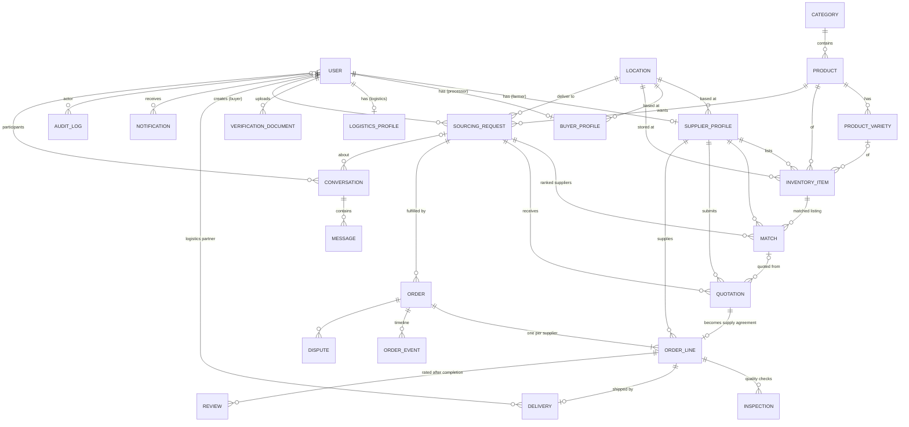

# Database schema

PostgreSQL 14+ (PostGIS optional but recommended). The schema is managed by Django migrations in `apps/*/migrations/`. To inspect it live, run `python manage.py sqlmigrate <app> 0001` or open `/django-admin/`.

## Entity relationship diagram

## Tables

### Identity and verification (`accounts`)
| Table | Key columns |
|---|---|
| `accounts_user` | `username`, `email` (unique), `role` (farmer · processor · logistics · admin), `phone`, `sms_opt_in`, `whatsapp_opt_in`, plus the standard auth fields |
| `accounts_supplierprofile` | `user` (1:1), `business_name`, `registration_number`, `location`, `can_deliver`, `delivery_radius_km`, `member_count`, `certifications`, **`verification_status`**, `verified_by/at`. Performance: `reliability_score`, `completed_orders`, `average_rating`, `on_time_rate`, `inspection_pass_rate` |
| `accounts_buyerprofile` | `user` (1:1), `business_name`, `business_type`, `monthly_volume_kg`, `location`, verification fields |
| `accounts_logisticsprofile` | `user` (1:1), `vehicle_capacity_kg`, `refrigerated`, `coverage_counties`, verification fields |
| `accounts_verificationdocument` | `owner`, `doc_type`, `file` (private storage), `original_name`, `status`, `reviewed_by` |

### Reference data (`core`, `catalog`)
| Table | Key columns |
|---|---|
| `core_location` | `name`, `county`, `sub_county`, `latitude`, `longitude`. A GiST geography index is added when PostGIS is available |
| `catalog_category` | `name`, `slug` |
| `catalog_product` | `category`, `name`, `default_unit`, `perishable`, `shelf_life_days`, `quality_parameters` (JSON list), `is_active` |
| `catalog_productvariety` | `product`, `name` (unique together) |
| `catalog_inventoryitem` | `supplier`, `product`, `variety`, `quantity_available`, `unit`, **`quality_grade`**, `quality_attributes` (JSON), `price_per_unit`, `location`, `harvest_date`, `available_from/until`, `can_deliver`, `packaging`, `is_active`, **`last_confirmed_at`**. Index on (`product`, `is_active`) |
| `core_matchingconfig` | Singleton row: six weights, `max_distance_km`, `min_score`, `allow_one_grade_below`, `max_matches`, `new_supplier_reliability`, `transport_km_per_day` |

### Sourcing (`sourcing`)
| Table | Key columns |
|---|---|
| `sourcing_sourcingrequest` | **`reference`** (unique, `SR-YYYY-NNNNNN`), `buyer`, `product`, `variety`, `quantity`, `unit`, `delivery_location`, `delivery_deadline`, `min_quality_grade`, `quality_specifications` (JSON, e.g. `{"min_size_mm": 70}`), `quality_notes`, `intended_application`, `packaging_requirements`, `target_budget`, `delivery_arrangement`, `status`, `last_matched_at` |
| `sourcing_match` | `sourcing_request`, `supplier`, `inventory_item` (unique with the request), `rank`, `score`, `score_breakdown` (JSON), `distance_km`, `available_quantity`, `suggested_quantity`, `confirmed_quantity`, `status`, `notified_at`, `responded_at` |
| `sourcing_quotation` | **`reference`** (`QT-…`), `sourcing_request`, `match`, `supplier`, `inventory_item`, `quantity`, `price_per_unit`, `delivery_cost`, `quality_grade`, `earliest_delivery_date`, `valid_until`, `status`, `revision`, `counter_*`, `history` (JSON trail) |

### Fulfilment (`orders`)
| Table | Key columns |
|---|---|
| `orders_order` | **`reference`** (`PO-…`), `sourcing_request`, `buyer`, `status`, `delivery_location`, `completed_at` |
| `orders_orderline` | `order`, `supplier`, `quotation` (1:1), `inventory_item`, `quantity`, `unit`, `price_per_unit`, `delivery_cost`, `quality_grade`, **`quality_specifications`** (snapshot for traceability), `agreed_delivery_date`, `status`, `reconfirmed_at`, `delivered_quantity`, `completed_at` |
| `orders_salerecord` | Purchase/sales history, written once when the buyer confirms receipt of a line. `order_line` (1:1), `order`, `buyer`, `supplier`, `inventory_item` (all `SET NULL`, so history survives deletions) plus copied `order_reference`, `buyer_name`, `supplier_name`, `product_name`, `variety_name`, `quality_grade`, `quantity` (delivered), `unit`, `price_per_unit`, `delivery_cost`, `total`, `delivered_to`, `completed_at`. Read-only in the admin. |
| `orders_inspection` | `order_line`, `stage` (pre_dispatch · on_receipt), `inspector`, `result`, `grade_observed`, `measurements` (JSON), `accepted/rejected_quantity`, `report` (private file) |
| `orders_delivery` | `order_line` (1:1), `logistics_partner`, `pickup/dropoff_location`, `status`, `scheduled_date`, vehicle and driver details, `picked_up_at`, `delivered_at`, `received_quantity`, `received_by`, `proof_of_delivery` (private file), `tracking_log` (JSON) |
| `orders_orderevent` | `order`, `order_line`, `actor`, `event`, `note`, `created_at`: the documented timeline |
| `orders_dispute` | `order`, `order_line`, `raised_by`, `reason`, `status`, `resolution`, `resolved_by/at` |

### Communication, feedback and audit
| Table | Key columns |
|---|---|
| `comms_conversation` (+ `_participants`) | `subject`, `sourcing_request`, `order` |
| `comms_message` (+ `_read_by`) | `conversation`, `sender`, `body`, `created_at` |
| `comms_notification` | `user`, `kind`, `title`, `body`, `link`, `channels_sent`, `read_at`. Index on (`user`, `read_at`) |
| `reviews_review` | `order_line`, `reviewer`, `reviewee`, `rating` (1 to 5), `quality/timeliness/communication_rating`, `comment`. Unique on (`order_line`, `reviewer`) |
| `core_auditlog` | `actor`, `action`, `target_type`, `target_id`, `target_repr`, `details` (JSON), `ip_address`, `created_at`. Append-only; indexed on target and time |

## Integrity choices

- **`PROTECT`** on foreign keys that hold transaction history (product, location, supplier on quotations and order lines, inventory on order lines, buyer on requests and orders). Catalogue or supplier rows can't be deleted out from under past trades; deleting a listing through the API only deactivates it.
- Quantities and money use `DECIMAL`, never floats. Order and quotation totals are rounded to 2 decimal places.
- Stock reservation runs inside a transaction with `SELECT … FOR UPDATE` on the inventory row.
- `unique_together`: (request, inventory item) on matches; (order line, reviewer) on reviews; (product, name) on varieties.
- Agreed quality terms are **copied** onto the order line, so later edits to the request or listing can't rewrite history.
